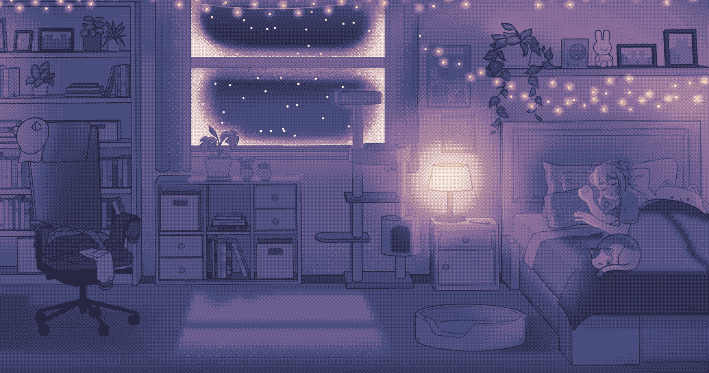

# 💫 About Me:

I'm yet another game developer ⭐  🔭 I’m currently working on "Wintermourn" 🌱 I’m currently using Lua Löve2D, C#/GDScript Godot and C# Unity 👨‍💻 All of my projects are available at https://just-alan.itch.io 📫 "memorysilver" on Discord, DMs are open! ⚡ Fun fact; i failed 8th grade math!

# 💻 Tech Stack:
           
# 📊 GitHub Stats:
 
 

### 🔝 Top Contributed Repo

---

  ## 💰 You can help me by Donating
   

  
<!-- Proudly created with GPRM ( https://gprm.itsvg.in ) -->
